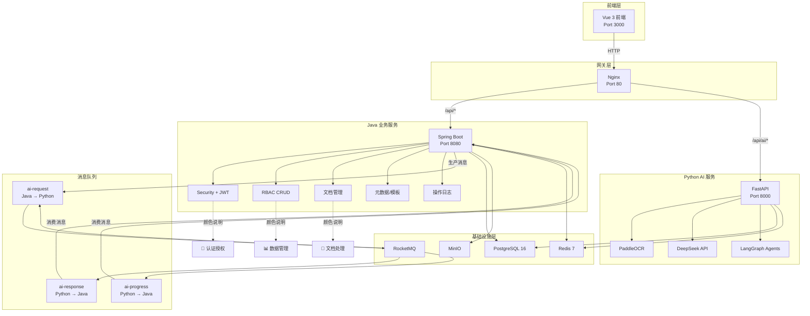
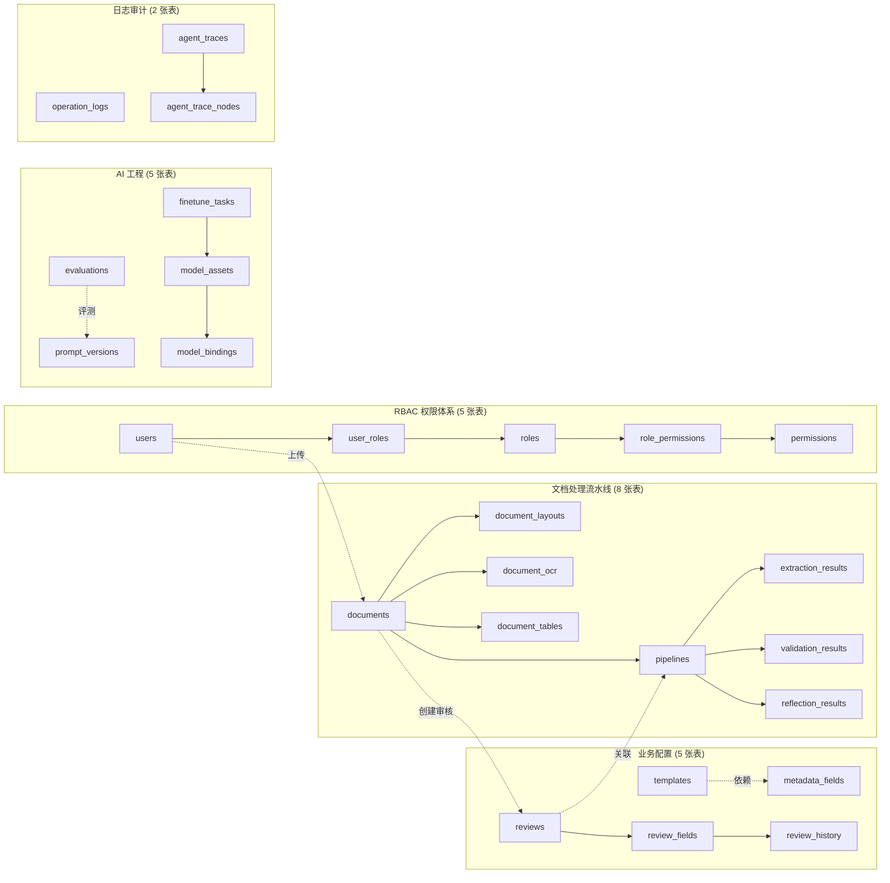

## 1. 高层总结（TL;DR）

**影响范围：** 🟢 **低** - 新增文档和配置文件，无代码逻辑变更

**核心变更：**
- ✨ **新增完整项目文档体系**：全栈开发计划、Phase 1 实施计划、数据库设计文档
- 🗄️ **设计 28 张数据库表**：涵盖 RBAC 权限、文档处理流水线、业务配置、AI 工程、日志审计五大模块
- 🐳 **基础设施配置**：Docker Compose、RocketMQ Broker、MinIO、PostgreSQL
- 📦 **依赖管理**：AI 技能锁定文件（skills-lock.json）
- 🔧 **Git 配置**：.gitignore 规则（忽略环境配置、Agent 技能、IDE 配置）

---

## 2. 可视化概述（架构与数据流）

### 2.1 项目架构全景图



### 2.2 数据库模块关系图



---

## 3. 详细变更分析

### 3.1 项目规划文档

#### 📄 **全栈开发计划.md**（新增）

**主要内容：**
- 定义了 **三层架构体系**：视觉感知层（Python）→ 认知推理层（Python）→ 业务应用层（Java）
- 规划了 **5 个实施阶段**（Phase 1-5），总计约 25 周开发周期
- 设计了 **服务间异步通信方案**（RocketMQ 模式 B），包含 3 个 Topic：
  - `ai-request`：Java → Python 处理请求
  - `ai-response`：Python → Java 处理结果
  - `ai-progress`：Python → Java 进度通知

**关键设计决策：**

| 设计项   | 方案                          | 理由                                                |
| -------- | ----------------------------- | --------------------------------------------------- |
| API 拆分 | Java 48 端点 + Python 18 端点 | Java 负责业务逻辑，Python 负责 AI 推理              |
| 消息队列 | RocketMQ                      | 支持延迟消息、事务消息，适合 AI 任务编排            |
| 文件存储 | MinIO                         | 兼容 S3 API，适合大规模文档存储                     |
| 数据库   | PostgreSQL 16                 | 支持 JSONB，适合存储版面、OCR、状态图等半结构化数据 |

---

#### 📄 **Phase1-Java后端实施计划.md**（新增）

**目标：** 第 1-5 周完成 Java Spring Boot 基础设施 + 非 AI 模块 CRUD

**交付清单（11 项）：**

| #    | 交付物                     | 关键技术                               |
| ---- | -------------------------- | -------------------------------------- |
| 1    | Spring Boot 3 脚手架       | pom.xml + 分层结构                     |
| 2    | Docker Compose 基础设施    | PostgreSQL + Redis + MinIO + RocketMQ  |
| 3    | MyBatis-Plus 实体 + Mapper | 28 张表对应 Entity                     |
| 4    | 种子数据                   | admin 用户 + 3 角色 + 38 权限          |
| 5    | JWT 认证系统               | access token (2h) + refresh token (7d) |
| 6    | RBAC 权限控制              | `@PreAuthorize` + 权限评估器           |
| 7    | AOP 操作日志切面           | 自动记录请求/响应/IP/耗时              |
| 8    | CRUD Controller            | 12 个模块控制器                        |
| 9    | 统一响应格式               | `{ code, data, message }`              |
| 10   | 前端对接真实 API           | 关闭 Mock 层                           |
| 11   | 验收测试                   | 登录 + CRUD + 上传文档                 |

**核心接口清单：**

```markdown
# Auth (4 端点)
POST   /api/auth/login
POST   /api/auth/refresh-token
POST   /api/auth/logout
GET    /api/auth/current-user

# Users (7 端点)
GET    /api/users
GET    /api/users/{id}
POST   /api/users
PUT    /api/users/{id}
DELETE /api/users/{id}
PUT    /api/users/{id}/status
PUT    /api/users/{id}/reset-password

# Documents (4 端点，Phase 1 仅上传+列表)
GET    /api/documents
POST   /api/documents/upload
GET    /api/documents/{id}
DELETE /api/documents/{id}
```

**暂不实现功能：**
- ❌ RocketMQ 消息通信（Phase 2）
- ❌ Pipeline 执行引擎（Phase 3）
- ❌ OCR、版面分析、表格重建（Phase 2）
- ❌ LangGraph 多智能体（Phase 3）
- ❌ 审核工作台（Phase 4）

---

### 3.2 数据库设计文档

#### 📄 **数据库设计文档.md**（新增）

**设计原则：**
- 统一使用 `BIGSERIAL` 主键（与前端 `number` 类型对齐）
- 时间字段统一 `TIMESTAMPTZ`（带时区的时间戳）
- 状态字段用 `VARCHAR` 枚举值（方便扩展）
- 半结构化数据用 `JSONB` 存储（版面、OCR、表格、状态图）
- 软删除用 `deleted_at` 字段（关键业务表）

#### 数据库表结构统计

| 模块           | 表数量 | 主要表名                                                     |
| -------------- | ------ | ------------------------------------------------------------ |
| RBAC 权限体系  | 5      | users, roles, permissions, user_roles, role_permissions      |
| 文档处理流水线 | 8      | documents, pipelines, extraction_results, validation_results |
| 业务配置       | 5      | metadata_fields, templates, reviews, review_fields           |
| AI 工程        | 5      | prompt_versions, evaluations, finetune_tasks, model_assets   |
| 日志审计       | 2      | operation_logs, agent_traces, agent_trace_nodes              |
| 其他           | 3      | webhook_config, export_history, model_bindings               |
| **总计**       | **28** |                                                              |

#### 核心表设计亮点

**1. `documents` 表 - 文档中心表**
```sql
CREATE TABLE documents (
    id              BIGSERIAL PRIMARY KEY,
    file_name       VARCHAR(500) NOT NULL,
    file_type       VARCHAR(20) NOT NULL,    -- pdf/jpg/png/word
    file_url        VARCHAR(1000) NOT NULL,  -- MinIO URL
    status          VARCHAR(30) DEFAULT 'pending',
    -- pending | preprocessing | processing | completed | failed
    created_at      TIMESTAMPTZ DEFAULT NOW()
);
```

**2. `pipelines` 表 - 处理流水线状态机**
```sql
CREATE TABLE pipelines (
    id              BIGSERIAL PRIMARY KEY,
    document_id     BIGINT REFERENCES documents(id),
    task_id         VARCHAR(36) UNIQUE,      -- UUID, RocketMQ 关联
    status          VARCHAR(20) DEFAULT 'pending',
    -- pending | running | completed | failed
    current_step    VARCHAR(50),             -- 当前步骤名
    total_steps     INT DEFAULT 6,
    completed_steps INT DEFAULT 0,
    state_graph     JSONB,                   -- { nodes[], edges[] }
    duration        DOUBLE PRECISION,        -- 处理耗时（秒）
    started_at      TIMESTAMPTZ,
    finished_at     TIMESTAMPTZ
);
```

**3. `document_layouts` 表 - 版面分析结果（JSONB）**
```sql
CREATE TABLE document_layouts (
    id          BIGSERIAL PRIMARY KEY,
    document_id BIGINT UNIQUE REFERENCES documents(id),
    image_url   VARCHAR(1000),              -- 标注后的可视化图片
    regions     JSONB DEFAULT '[]',
    -- regions[i]: { id, label, x, y, width, height, color, type, confidence }
    confidence  DOUBLE PRECISION
);
```

**4. `extraction_results` 表 - 字段提取结果**
```sql
CREATE TABLE extraction_results (
    id              BIGSERIAL PRIMARY KEY,
    pipeline_id     BIGINT REFERENCES pipelines(id),
    field_name      VARCHAR(100) NOT NULL,
    field_code      VARCHAR(100) NOT NULL,
    extracted_value TEXT,
    confidence      DOUBLE PRECISION DEFAULT 0,    -- 0-1
    status          VARCHAR(20) DEFAULT 'uncertain',
    -- verified | uncertain | rejected
    page_ref        INT                             -- 页码引用
);
```

#### 权限种子数据（38 条权限）

**权限树结构：**
```
系统管理 (system)
├── 用户管理 (user) - 7 个权限
├── 角色管理 (role) - 6 个权限
└── 权限管理 (permission) - 5 个权限

文档管理 (document) - 5 个权限

元数据与模板 (metadata) - 9 个权限

审核工作台 (review) - 8 个权限
└── 字段审核 (review:field) - 3 个权限

日志审计 (log) - 4 个权限

AI 能力 (ai) - 暂不实现（Phase 2+）
```

---

#### 📄 **init-db.sql**（新增，716 行）

**完整功能：**
- ✅ 创建数据库 `biz_form_recog_db`
- ✅ 按依赖顺序删除所有表（级联删除）
- ✅ 创建 28 张表（含索引）
- ✅ 插入种子数据：
  - 1 个 admin 用户（密码：`$2a$10$...` BCrypt 哈希）
  - 3 个角色（admin, reviewer, operator）
  - 38 条权限（树形结构）

**关键索引设计：**

| 表名               | 索引                                                         | 查询场景                        |
| ------------------ | ------------------------------------------------------------ | ------------------------------- |
| users              | `idx_users_status`, `idx_users_deleted_at`                   | 用户列表、软删除过滤            |
| permissions        | `idx_permissions_parent`, `idx_permissions_type`             | 权限树查询、类型过滤            |
| documents          | `idx_documents_status`, `idx_documents_file_type`, `idx_documents_created_at` | 文档列表（多条件筛选）          |
| pipelines          | `idx_pipelines_status`, `idx_pipelines_task_id`              | 管道状态查询、RocketMQ 消息关联 |
| extraction_results | `idx_extraction_status`                                      | 待审核字段查询                  |
| reviews            | `idx_reviews_status`, `idx_reviews_reviewer`                 | 审核任务分配                    |

---

### 3.3 基础设施配置

#### ⚙️ **rocketmq/broker.conf**（新增）

**配置项说明：**

| 配置项                  | 值                      | 说明                            |
| ----------------------- | ----------------------- | ------------------------------- |
| `brokerClusterName`     | `DefaultCluster`        | 集群名称                        |
| `brokerName`            | `broker-a`              | Broker 名称                     |
| `brokerId`              | `0`                     | 0 = Master                      |
| `deleteWhen`            | `04`                    | 凌晨 4 点清理过期消息           |
| `fileReservedTime`      | `48`                    | 消息保留 48 小时                |
| `brokerRole`            | `ASYNC_MASTER`          | 异步刷盘（高性能）              |
| `flushDiskType`         | `ASYNC_FLUSH`           | 异步刷盘                        |
| `autoCreateTopicEnable` | `true`                  | 自动创建 Topic（开发环境）      |
| `namesrvAddr`           | `rocketmq-namesrv:9876` | NameServer 地址（容器内服务名） |

---

#### 🚫 **.gitignore**（新增）

**忽略规则：**

| 模式               | 说明                           |
| ------------------ | ------------------------------ |
| `.env`             | 环境变量文件（包含敏感信息）   |
| `.agents/skills/*` | Agent 技能缓存目录             |
| `.claude/*`        | Claude AI 配置                 |
| `.trae/*`          | Trae AI 配置                   |
| `.idea/*`          | JetBrains IDE 配置             |
| `backend-java/*`   | Java 后端代码（独立 Git 仓库） |
| `frontend/*`       | 前端代码（独立 Git 仓库）      |

**设计意图：** 项目采用 **Monorepo（多仓库）** 模式，主仓库仅包含配置和文档，代码分散在子仓库。

---

#### 🔒 **skills-lock.json**（新增）

**AI 技能依赖锁定：**

| 技能名称                  | 来源                   | 用途          |
| ------------------------- | ---------------------- | ------------- |
| `brandkit`                | `Leonxlnx/taste-skill` | 品牌设计规范  |
| `design-taste-frontend`   | `Leonxlnx/taste-skill` | 前端设计风格  |
| `minimalist-ui`           | `Leonxlnx/taste-skill` | 极简主义 UI   |
| `industrial-brutalist-ui` | `Leonxlnx/taste-skill` | 工业野兽派 UI |
| `image-to-code`           | `Leonxlnx/taste-skill` | 图片转代码    |
| `gpt-taste`               | `Leonxlnx/taste-skill` | GPT 风格生成  |
| `full-output-enforcement` | `Leonxlnx/taste-skill` | 完整输出强制  |

**设计目的：** 确保前端 UI 风格一致性，锁定特定版本的 AI 辅助设计技能。

---

## 4. 影响与风险评估

### 4.1 ✅ 无破坏性变更

**本次变更纯增量，无任何破坏性修改：**
- 仅新增文件（`.gitignore`、文档、SQL、配置）
- 无现有代码修改
- 无数据库结构变更（因为这是初始化脚本）

---

### 4.2 ⚠️ 潜在风险与建议

| 风险项                      | 风险等级 | 缓解措施                                                     |
| --------------------------- | -------- | ------------------------------------------------------------ |
| **数据库脚本硬编码密码**    | 🔴 高     | `init-db.sql` 中 admin 密码为测试密码，生产环境必须修改      |
| **RocketMQ 自动创建 Topic** | 🟡 中     | `autoCreateTopicEnable=true` 仅适合开发，生产环境应手动创建  |
| **软删除字段缺失**          | 🟡 中     | 部分日志表未设置 `deleted_at`，需明确是否需要软删除          |
| **字段长度限制**            | 🟢 低     | `documents.file_url` 最大 1000 字符，MinIO URL 可能超长，建议测试验证 |
| **JSONB 查询性能**          | 🟢 低     | `regions`、`entries` 等字段未建 GIN 索引，后续查询可能较慢，建议添加：`CREATE INDEX idx_doc_layouts_regions ON document_layouts USING GIN (regions);` |

---

### 4.3 🧪 测试建议

**数据库初始化测试：**
```bash
# 1. 执行初始化脚本
docker exec -i postgres psql -U platform -d platform_db < init-db.sql

# 2. 验证表创建
psql -U platform -d platform_db -c "\dt"

# 3. 验证种子数据
psql -U platform -d platform_db -c "SELECT username, nickname FROM users;"
psql -U platform -d platform_db -c "SELECT COUNT(*) FROM permissions;"  -- 应返回 38
psql -U platform -d platform_db -c "SELECT COUNT(*) FROM roles;"       -- 应返回 3
```

**RocketMQ 启动测试：**
```bash
# 1. 启动 RocketMQ
docker compose up -d rocketmq-namesrv rocketmq-broker

# 2. 验证 Broker 连接 NameServer
docker logs rocketmq-broker | grep "The broker boot success"
```

**文档验证测试：**
1. 确认 **全栈开发计划.md** 与 **Phase 1 计划.md** 的技术栈一致性
2. 确认 **数据库设计文档.md** 中的表结构与 `init-db.sql` 实际脚本一致
3. 确认 `.gitignore` 规则不会意外忽略重要文件

---

## 5. 总结

本次变更完成了项目的**基础设施规划和初始化**，包括：

1. 📋 **完整的开发路线图**（5 个阶段，25 周周期）
2. 🗄️ **28 张数据库表设计**（RBAC + 文档流水线 + AI 工程）
3. 🚀 **Docker 基础设施配置**（PostgreSQL + MinIO + Redis + RocketMQ）
4. 🔐 **JWT + RBAC 权限体系设计**（38 条权限种子数据）
5. 🤖 **AI 技能依赖锁定**（确保 UI 风格一致性）

**下一步行动：**
- [ ] 执行 `init-db.sql` 初始化数据库
- [ ] 配置 Docker Compose 启动基础设施
- [ ] 创建 Java Spring Boot 项目脚手架（Phase 1 Step 2）
- [ ] 生成 MyBatis-Plus 实体类（28 张表 → 28 个 Entity）

---